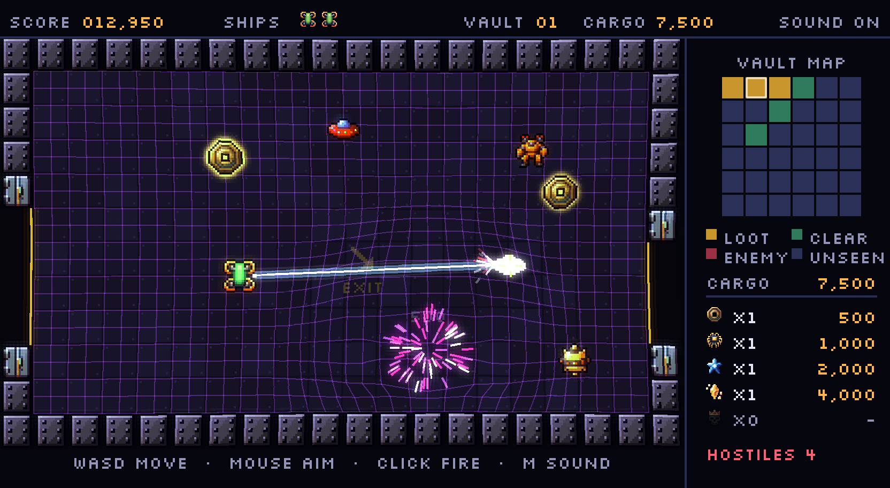

<div align="center">

# Space Raider

**Blast the hostiles. Grab what glows. Get out alive.**

A twin-stick vault raid across 36 rooms, with neon effects. It runs in the browser on desktop, gamepad or phone.

### [▶ Play it now](https://leeeeeroyj.github.io/space-raider/)

[](https://github.com/leeeeeroyj/space-raider/actions/workflows/deploy.yml)


[](LICENSE)



</div>

## About

Space Raider is an original arcade game inspired by the mechanics of Taito's early-1980s arcade game *Space Dungeon*. Each run drops you into a vault of 6 × 6 rooms. Fight your way through, fill your hold with treasure, and reach the extraction pad before you run out of ships.

- **A new vault every run.** Each vault is a randomly generated maze with extra loops. The exit is always the room farthest from the entrance, and a floor arrow in each room points toward it.
- **Twin-stick shooting with a continuous beam.** Move with one stick and aim with the other, in any direction.
- **Neon effects.** The floor grid warps around explosions, kills burst into sparks, and bright things glow. Big hits bend the lens and swing the colours.
- **Sound with no audio files.** Every sound effect is generated in code, sfxr style, when the game loads.
- **Plays anywhere.** Keyboard and mouse, an Xbox-style controller, or touch on a phone held sideways.

## How to play

Fly from room to room through the doorways. The **vault map** shows which rooms still hold loot, which still have hostiles, and which you've cleared.

- **Treasure only scores once you bank it.** Pick it up, carry it to the **extraction pad**, and land on it to cash in. The pad takes you to the next, harder vault.
- **When you lose a ship, your cargo drops where you died.** The room is marked with an ✕ on the map. You respawn at the vault entrance and can go back for it.
- **Bonuses:** an extra ship every 10,000 points, and 10,000 more for visiting all 36 rooms before you leave.

| Treasure | Value |
| --- | ---: |
| Scrap Coin | 500 |
| Data Core | 1,000 |
| Star Shard | 2,000 |
| Relic Crystal | 4,000 |
| Ancient Idol | 8,000 |

| Hostile | Points | Behaviour |
| --- | ---: | --- |
| Hunter drone | 100 | Streams in through the doorways and chases you. |
| Sentry | 25 | A corner turret that flashes before it fires. |
| Drift mine | 25 | Moves in straight diagonal lines and bounces off the walls. |
| Warden | 125 | Tough, and guards the loot in its room. |
| Brood pod | 500 | Keeps hatching drones, up to three at a time, until you destroy it. |
| Scavenger | 50 | Can't be killed. It steals your best cargo; shoot it to make it drop the loot, or it hides the loot in another room. |

## Controls

| | Keyboard + mouse | Controller | Touch |
| --- | --- | --- | --- |
| Move | WASD | Left stick | Left circle |
| Aim | Mouse | Right stick | Right circle |
| Fire | Hold left click | Right stick or RT | Right circle |
| Sound on / off | M | Y | Tap **SOUND** (top right) |

On a phone, turn the screen sideways. On wide screens the touch sticks sit in the empty space beside the game, so they don't cover the action.

## Run it locally

You need [Node.js](https://nodejs.org/) 20.19+ or 22.12+.

```bash
npm install
npm run dev        # http://localhost:5173
npm run build      # type-check and build to dist/
```

Every push to `main` builds the game and deploys it to GitHub Pages.

## Project layout

```
src/
  main.ts            game setup
  config.ts          tunables: speeds, points, colours, effect settings
  vault.ts           vault generation (maze, loot, hostiles)
  controls.ts        keyboard, mouse and gamepad input
  touch.ts           on-screen touch sticks
  effects.ts         warp grid, sparks, bloom, screen wobble
  sfx.ts             procedural sound effects
  scenes/            title screen, game room and HUD
assets/sprites/      the game's 16 × 16 sprites
design/              concept sheet used to pick the sprites
tools/sprites.py     sprite search and export script
```

## Credits

- **Sprites:** from the CC0 [Angais/pixel-art-atlas-1.4m](https://huggingface.co/datasets/Angais/pixel-art-atlas-1.4m) collection of AI-generated pixel art, found with [Pixel Search](https://huggingface.co/spaces/cfahlgren1/pixel-search).
- **Font:** [Silkscreen](https://fonts.google.com/specimen/Silkscreen) by Jason Kottke (SIL Open Font License).
- **Engine:** [Phaser](https://phaser.io/).
- **Inspiration:** Taito's *Space Dungeon* arcade game. Space Raider is an original game and isn't affiliated with or endorsed by the original's rights holders.

## License

The code is released under the [MIT License](LICENSE). The sprites in `assets/sprites/` and `design/` are CC0 (public domain), and the Silkscreen font is under the SIL Open Font License.
